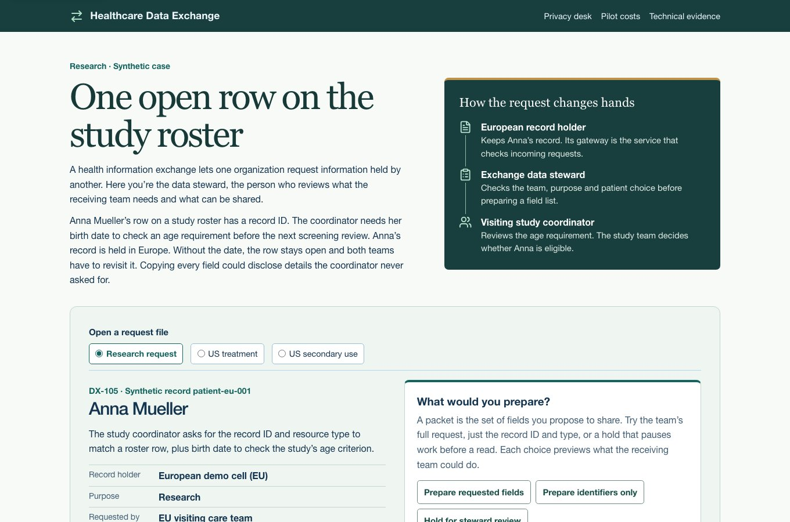

# Healthcare Data Exchange

**A research consent case for an exchange privacy steward and pilot sponsor, with a FHIR, OPA and OPAL reference backend.**

[**Open the live demo →**](https://safetymp.github.io/Healthcare-Data-Exchange/) · [Frontend setup](web/README.md) · [Documentation](docs/README.md) · [Contributing](CONTRIBUTING.md)

**For exchange operators.** Anna has withdrawn research permission. The privacy officer needs to know what the European gateway will do when the same team asks again. Inspect the source and receiver records, decide what you can report, and try the other evidence file. The companion guide traces the same decision through the rule mirror and consent-data update. [Open the operator case](https://safetymp.github.io/Healthcare-Data-Exchange/#operator) · [Operator technical guide](https://safetymp.github.io/Healthcare-Data-Exchange/#operator-guide)

[](https://github.com/SafetyMP/Healthcare-Data-Exchange/actions/workflows/pages.yml)
[](https://github.com/SafetyMP/Healthcare-Data-Exchange/actions/workflows/portfolio-verify.yml)
[](https://github.com/SafetyMP/Healthcare-Data-Exchange/actions/workflows/codeql.yml)

[](https://safetymp.github.io/Healthcare-Data-Exchange/#research-request)

Healthcare data access depends on more than finding a record. The purpose of a
request, the requesting team's permissions, the patient's consent, and regional
restrictions can all change what is returned. This project makes those decisions
visible and lets you explore how they interact.

The public demo works without an account or backend setup. All patients and
outcomes are synthetic. It is an educational and product-design reference, not a
clinical record system, a production health information exchange, or compliance
certification.

## Try the privacy desk case

A study coordinator needs a birth date to check one roster row. Inspect Anna Mueller’s synthetic EU request as the exchange steward. Prepare the requested fields, prepare identifiers only, or hold the packet and see what the receiving team can do. Replay Anna’s grant or withdrawal and trace the same decision through the technical guide. [Open the privacy desk](https://safetymp.github.io/Healthcare-Data-Exchange/#research-request)

Choose **Inspect this request’s field evidence** to carry the patient, requester, purpose and selected consent into the compact implementation guide. Compare the opposite consent without changing the patient’s tab preference, trim an authorized field preview, and inspect what a receiving gateway has yet to show. The stage and trial have shareable links. [Technical example](https://safetymp.github.io/Healthcare-Data-Exchange/#technical/research/withheld/fields/selected) · [Operations guide](docs/exchange-operations.md)

The exchange director can keep the manual desk, introduce a checklist, or test a policy check alongside staff decisions. The worksheet estimates how many reviewer minutes per eligible request would cover integration, training and support. Its starting values are illustrative. Before expanding, the steward checks whether a shadow recommendation would release an unauthorized field or hold an eligible request. The operations director then compares the time saved against the better manual or checklist baseline and decides whether the team could reuse that time. [Explore the pilot worksheet](https://safetymp.github.io/Healthcare-Data-Exchange/#pilot-costs)

The audience comes from two operating perspectives. Maryland’s CRISP exchange describes the route from a research team’s request through governance review. AHRQ guides exchange evaluation teams to identify stakeholders and feasible measures before judging value. The demo assigns those decisions to a fictional steward and operations director. [CRISP research access](https://www.crisphealth.org/research/) · [AHRQ exchange evaluation guide](https://digital.ahrq.gov/health-information-exchange-hie-evaluation-toolkit)

## Choose your starting point

| You want to… | Start here |
|---|---|
| Understand consent and access decisions | [Research consent case](https://safetymp.github.io/Healthcare-Data-Exchange/) |
| Review the experience or suggest improvements | [Product scope](docs/product-mandate.md), [independent experience review](docs/live-experience-review.md) |
| Run or change the frontend | [Web workspace guide](web/README.md) |
| Investigate FHIR, policy enforcement, or consent distribution | [Reference backend setup](#run-the-reference-backend), [architecture](docs/architecture/overview.md) |
| Contribute with a coding agent | [Contributing](CONTRIBUTING.md), then [AGENTS.md](AGENTS.md) |

## Trace the disclosure decision in code

1. **Reconstruct the steward’s packet.** The browser evaluates a synthetic patient, requester, purpose and consent choice. The field manifest then checks whether every proposed field is available for the selected plan. Holding the request stages zero fields. The case never transmits the packet. [Browser access model](web/src/lib/demo.ts) · [Packet projection and guide](web/src/components/clinical/case-evidence.tsx) · [Steward decision tests](web/tests/e2e/demo.spec.ts)
2. **Follow a connected patient read.** The Go gateway resolves the caller, asks Open Policy Agent (OPA) for a decision, and on an allowed read fetches the patient from the routed FHIR store. It filters the response to the fields specified by the policy and records the result. The study team still assesses eligibility. [Gateway read handler](services/gateway/internal/handlers/handlers.go) · [Canonical access rule](policy/authz.rego) · [Policy tests](policy/authz_test.rego)
3. **Trace a withdrawal at the receiver.** In the separate operator case the patient and request stay fixed while the available gateway observation changes. Its guide follows the published rule, the consent service’s separate OPAL data update and the result observed at one gateway. The two receiver files are fictional. The local Compose probe exercises a research read against a running gateway. [Operator evidence model](web/src/components/clinical/operator-model.ts) · [Consent update publisher](services/consent-service/chex_consent/opal_publish.py) · [Running gateway probe](scripts/demo.sh)

## Two execution modes

| | Browser demo on GitHub Pages | Local reference backend |
|---|---|---|
| Purpose | Explore the experience and synthetic access scenarios | Exercise service integration and policy enforcement |
| Data and state | Anna’s record from the four-patient fixture set; tab-local consent and activity | Synthetic FHIR R4 patients in EU and US HAPI stores; local consent service |
| Decisions | Simplified browser fixture rules | Go gateway, verified demo credentials, OPA policy and OPAL consent distribution |
| Setup | Open a URL | Docker Compose plus the local frontend |
| Evidence | Frontend interactions, accessibility checks, static route behavior | Hermetic service tests and separate Compose scenarios |

The browser demo makes no gateway API requests and does not run OPA, OPAL, HAPI,
or a clinical AI model. Its outcomes do not establish live policy enforcement,
actual data residency, clinical validity, or legal compliance. The reference
backend uses development credentials and service stubs; it is also not a
production deployment. Neither mode accepts real protected health information.

## Run the browser demo locally

Requires Node.js **22** and npm **10.9.2–10.x**, as declared in
[web/package.json](web/package.json).

```bash
git clone https://github.com/SafetyMP/Healthcare-Data-Exchange.git
cd Healthcare-Data-Exchange/web
npm ci
npm run build:demo
npm run preview:demo
```

Open `http://127.0.0.1:3100/Healthcare-Data-Exchange/`.
For development, mode settings, tests, and publishing, see [web/README.md](web/README.md).

## Run the reference backend

From the repository root, with Docker Compose available:

```bash
./scripts/run-dev.sh
./scripts/demo.sh
./scripts/adversarial.sh
```

The startup script builds the services, creates gitignored development secrets on
first run, and waits for service health. HAPI startup can take several minutes.
The cooperative demo exercises synthetic reads and consent changes; the adversarial
script checks authorization and residency denial paths. See
[backend architecture and data flows](docs/architecture/overview.md) for the service boundaries.

In another terminal, start the gateway-backed frontend with the browser-demo
switch unset:

```bash
cd web
npm ci
npm run dev
# http://localhost:3100
```

Stop the local stack when finished:

```bash
./scripts/teardown-dev.sh
```

Default teardown retains data volumes. Never commit generated secrets or use real
patient data. The [security policy](SECURITY.md) describes reporting and boundaries.

## Verification and evidence

| Check | Command | What it covers |
|---|---|---|
| Browser demo | `cd web && npm run verify:demo` | Adapter and metadata tests, TypeScript, static export checks, browser journeys and automated accessibility |
| Gateway frontend | `cd web && npm run verify` | TypeScript, server-mode build and frontend smoke/accessibility checks |
| Reference services | `./scripts/verify.sh` | Repository contracts, OPA tests, Go vet/tests and Python lint/tests; no Compose |
| Running stack | `./scripts/demo.sh` and `./scripts/adversarial.sh` | Cooperative and adversarial service scenarios; requires Compose |

Install Chromium for frontend tests with `cd web && npx playwright install chromium`.
The hermetic backend gate requires Go **1.22+**, Python **3.12+**, PyYAML, and
`curl`; its first run may download pinned OPA and install local Python environments.
The [contribution guide](CONTRIBUTING.md) documents environment details and checks.

[GitHub Actions](https://github.com/SafetyMP/Healthcare-Data-Exchange/actions) records
remote check results. A passing frontend or hermetic test is not proof of a live
exchange. [Review records](docs/README.md#design-and-verification-records) describe
expert inspection and synthetic regression testing; improved customer engagement
has not been measured.

## Repository map

| Path | Responsibility |
|---|---|
| [`web/`](web/) | Next.js 16 / React / TypeScript workspace; browser demo and gateway mode |
| [`fhir/samples/`](fhir/samples/) | Synthetic FHIR Patient fixtures |
| [`services/`](services/) | Go gateway and Python consent, identity, and AI-governance references |
| [`policy/`](policy/) and [`config/`](config/) | Canonical OPA rules and demo routing/identity configuration |
| [`deploy/`](deploy/) | Local Compose stack |
| [`docs/`](docs/) | Current product scope, architecture, design records, and historical context |

Policy changes belong in this repository. The separate
[healthcare-policy](https://github.com/SafetyMP/healthcare-policy) repository is a
mirror, maintained by the existing sync workflow; see
[ADR 0007](docs/adr/0007-opal-policy-mirror.md). Frontend changes do not require
policy publication.

## Contribute and reuse

Read [CONTRIBUTING.md](CONTRIBUTING.md) for development and review, [SUPPORT.md](SUPPORT.md)
for questions, and [SECURITY.md](SECURITY.md) for private vulnerability reporting.
The [roadmap](docs/roadmap.md), [changelog](CHANGELOG.md), and [governance](GOVERNANCE.md)
explain direction, history, and decisions. Citation metadata is in [CITATION.cff](CITATION.cff).

Licensed under **Apache License 2.0**. See [LICENSE](LICENSE) and [NOTICE](NOTICE).
