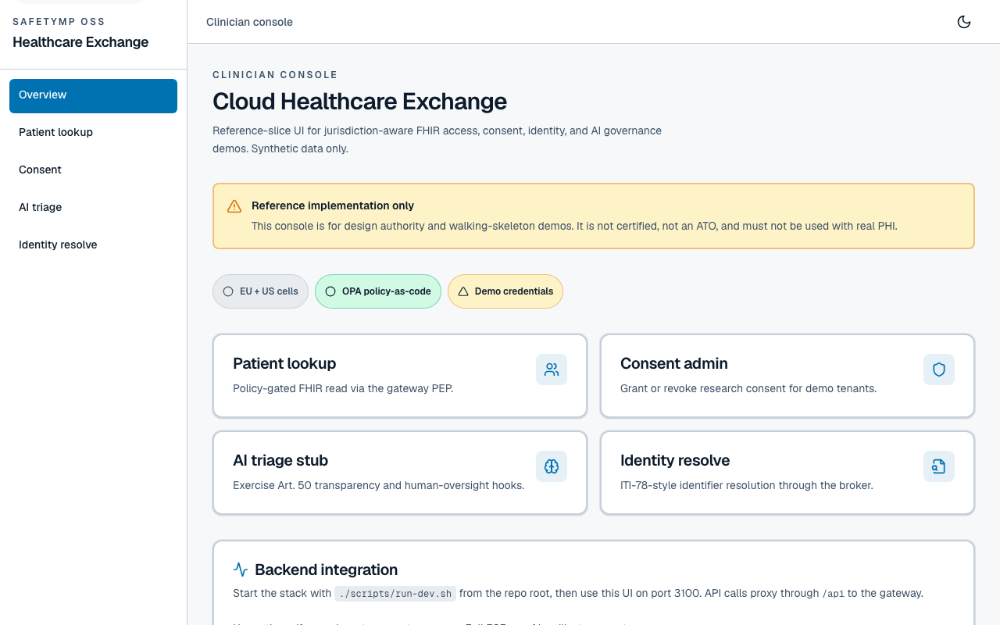
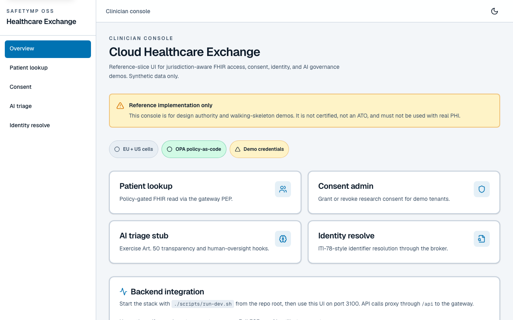
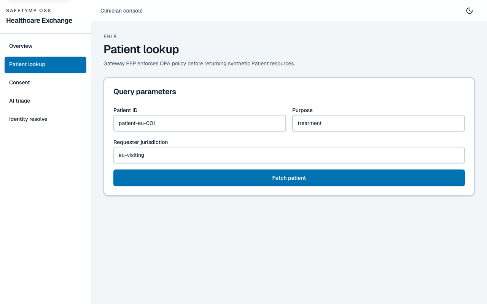
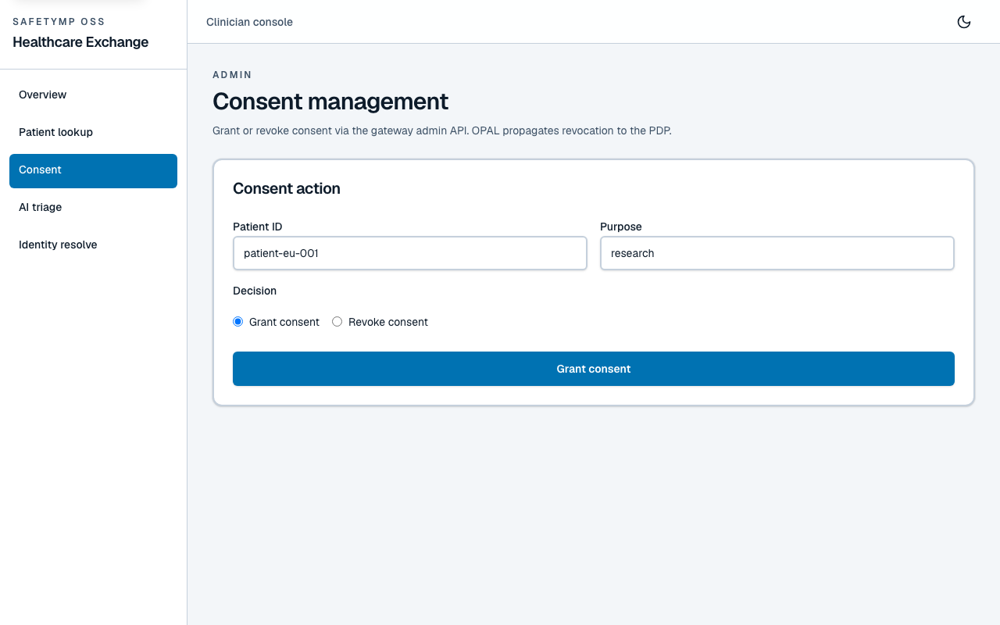
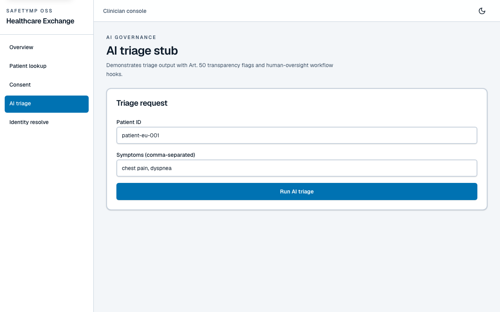
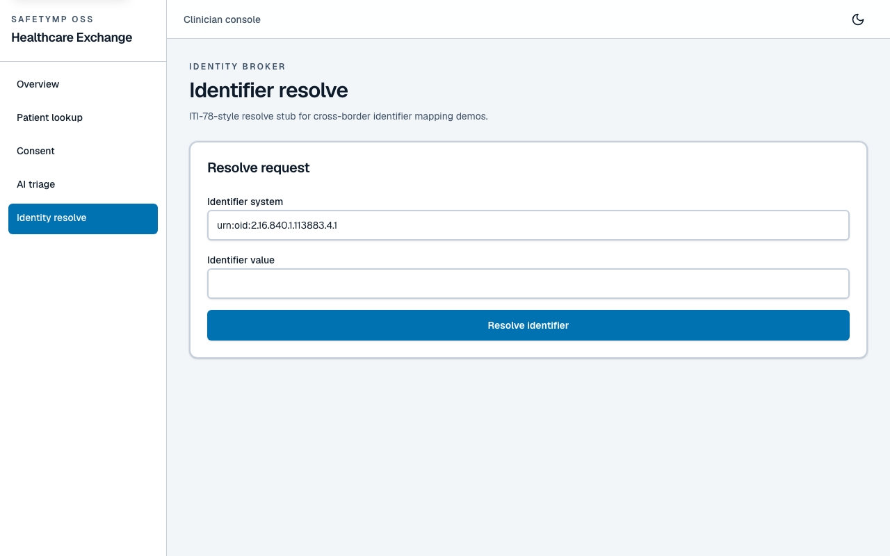
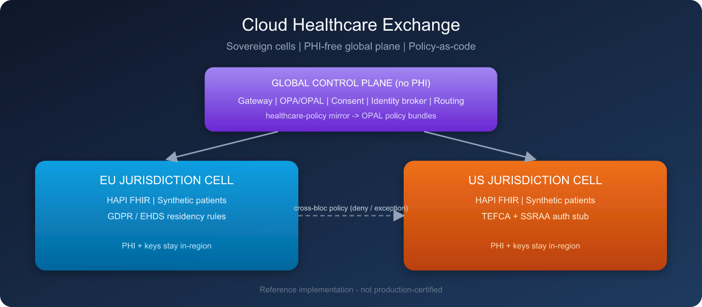
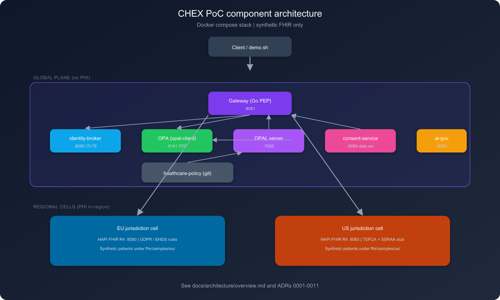
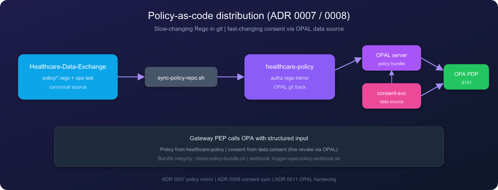
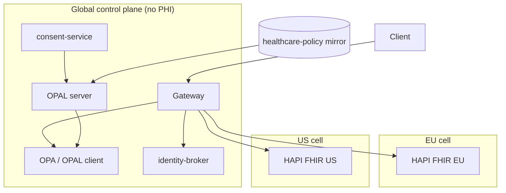

<h1 align="center">Synthetic FHIR cell demo</h1>

<p align="center">
  One Compose stack. A synthetic FHIR R4 Patient is read from an EU or US HAPI cell only after a per-cell bearer passes OPA. Revoking research consent makes the next research read return 403.
</p>

<p align="center">
  <a href="https://github.com/SafetyMP/Healthcare-Data-Exchange/actions/workflows/portfolio-verify.yml"></a>
  <a href="https://github.com/SafetyMP/Healthcare-Data-Exchange/actions/workflows/demo-e2e.yml"></a>
  <a href="https://github.com/SafetyMP/Healthcare-Data-Exchange/actions/workflows/codeql.yml"></a>
  <a href="https://scorecard.dev/viewer/?uri=github.com/SafetyMP/Healthcare-Data-Exchange"></a>
  <a href="LICENSE"></a>
  <a href="https://github.com/SafetyMP/Healthcare-Data-Exchange/releases/tag/v0.5.0"></a>
</p>

<p align="center">
  <a href="#quick-start">Quick start</a> ·
  <a href="#demo">Demo</a> ·
  <a href="#what-the-demo-proves">Scenarios</a> ·
  <a href="#architecture">Architecture</a> ·
  <a href="docs/README.md">Docs</a> ·
  <a href="CONTRIBUTING.md">Contributing</a> ·
  <a href="SECURITY.md">Security</a>
</p>

---

This demo runs [HAPI FHIR](https://github.com/hapifhir/hapi-fhir) as the EU and US cell stores and [OPAL](https://github.com/permitio/opal) to push consent into OPA. It does not replace either project, and it is not a health-information exchange or a clinical record system.

Synthetic records only. Jurisdiction comes from the per-cell bearer, not from a query parameter. `./scripts/verify.sh` runs the hermetic tests. `./scripts/demo.sh` runs the Compose path, including the research consent revoke.

## Demo

<p align="center">
  
</p>

### Screenshots

| Overview | Patient lookup | Consent | AI triage |
|:--------:|:--------------:|:-------:|:---------:|
|  |  |  |  |

| Identity resolve |
|:----------------:|
|  |

The **clinician console** in [`web/`](web/) proxies gateway APIs for local demos. Start the backend with `./scripts/run-dev.sh`, then `cd web && npm install && npm run dev` on port **3100**. Regenerate visuals with `cd web && npm run screenshots` (requires a running dev server); see [`docs/assets/README.md`](docs/assets/README.md).

_Synthetic FHIR only — no real PHI._

## What the running stack does

HAPI serves the synthetic Patient. The gateway asks OPA before it returns that Patient. OPAL delivers a consent revoke, and the next research read is 403. Treatment is consent-gated the same way: a purpose string does not skip the check.

## Architecture overview

| Jurisdiction cells | Component architecture | Policy + OPAL flow |
|:------------------:|:----------------------:|:------------------:|
|  |  |  |

_Diagrams show jurisdiction cells and policy distribution — not clinical UI._

## Quick start

**Prerequisites:** Docker, Go 1.22+, Python 3.12+, `curl`, and PyYAML (`pip install pyyaml` for local `./scripts/verify.sh`)

```bash
git clone https://github.com/SafetyMP/Healthcare-Data-Exchange.git
cd Healthcare-Data-Exchange

# One job, no Compose: a TEFCA purpose the bearer was not granted is forwarded
# for policy to reject, and a missing Patient is an error, not a sample file.
# Treatment does not require research consent (HIPAA payment/treatment/operations).
cd services/gateway && CGO_ENABLED=0 go run ./cmd/xpcheck

# Hermetic definition of done (no Docker; first run may download OPA + Python venvs)
cd ../..
./scripts/verify.sh

# Full stack: EU + US HAPI, OPAL, gateway, services (~2 min JVM boot)
./scripts/run-dev.sh

# End-to-end proof (compose must be running; this is the runtime acceptance gate)
./scripts/demo.sh

# Tear down when finished
./scripts/teardown-dev.sh

# Clinician console (optional — requires backend stack above)
cd web && npm install && npm run dev   # http://localhost:3100
```

First `run-dev.sh` generates local OPAL dev secrets under `deploy/opal/` (gitignored).

## What the demo is designed to prove

**Status:** Rows below describe **target** E2E behaviour exercised by `./scripts/demo.sh`. They are **not** claims about production readiness. A row becomes a verified claim only when `demo.sh` exits 0 locally and in [`.github/workflows/demo-e2e.yml`](.github/workflows/demo-e2e.yml) against Compose.

| Scenario | Target evidence (via `demo.sh`) |
|:---------|:---------|
| Intra-EU treatment read | EU-cell caller credential → residency + minimum-necessary fields |
| Research without consent | `403 policy_denied` (reason: `consent_required`) |
| Cross-bloc deny / exception | Deny-by-default + derivative exception when credential permits |
| US TEFCA + SSRAA stub | 401 without US association; 200 with US SSRAA bearer |
| Identity broker (ITI-78) | Direct resolve + gateway patient read by identifier |
| Live consent revoke/grant | 403↔200 via OPAL with no restart |
| AI triage gate | Human oversight required (Art. 50 transparency stub) |
| Tenant crypto-shred | 410 Gone after key destruction |

**Hermetic tests (`verify.sh`)** cover Rego policy, gateway handler + real bundle integration, and service stubs — but **do not** start Compose or HAPI. **Do not** cite `verify.sh` alone as proof of cross-bloc or demo scenarios.

## Architecture

<p align="center">
  
</p>

<p align="center">
  
</p>



| Service | Port | Role |
|---------|------|------|
| Gateway | 8081 | Jurisdiction router, OPA PEP, admin APIs |
| OPA (opal-client) | 8181 | Policy decision point |
| OPAL server | 7002 | Policy + consent sync |
| consent-service | 8084 | Dynamic consent + OPAL publish |
| identity-broker | 8085 | Preferred-identifier resolve |
| ai-governance | 8082 | AI triage + oversight stub |
| HAPI EU / US | 8080 / 8083 | Synthetic FHIR R4 patients |

## Repository layout

| Path | Purpose |
|------|---------|
| `services/gateway/` | Go jurisdiction router + PEP |
| `services/consent-service/` | OPAL consent data source |
| `services/identity-broker/` | ITI-78 identifier broker |
| `services/ai-governance/` | AI governance stub |
| `policy/` | Canonical OPA Rego (+ tests) |
| `config/` | Routing, **eu-auth**, SSRAA (US), identity registry, OPAL profile |
| `deploy/docker-compose.yml` | EU + US cells + OPAL stack |
| `web/` | Next.js clinician console (BFF → gateway) |
| `docs/` | Mandate, architecture, ADRs, roadmap |
| `scripts/verify.sh` | Hermetic definition of done |
| `scripts/demo.sh` | Compose E2E demonstration |

## Multi-repo portfolio

Policy consumed by OPAL is mirrored to [healthcare-policy](https://github.com/SafetyMP/healthcare-policy). Edit `policy/*.rego` here, run `./scripts/sync-policy-repo.sh`, then `./scripts/demo.sh`. See [specs/portfolio.yaml](specs/portfolio.yaml) and [ADR 0007](docs/adr/0007-opal-policy-mirror.md).

## Documentation

| Resource | Link |
|----------|------|
| Docs index | [docs/README.md](docs/README.md) |
| Roadmap | [docs/roadmap.md](docs/roadmap.md) |
| ADRs | [docs/adr/](docs/adr/) (0001–0011) |
| Compliance mapping | [docs/architecture/compliance-mapping.md](docs/architecture/compliance-mapping.md) |
| Changelog | [CHANGELOG.md](CHANGELOG.md) |
| Governance | [GOVERNANCE.md](GOVERNANCE.md) |
| Cite this repo | [CITATION.cff](CITATION.cff) |

## Contributing

Contributions welcome. Read [CONTRIBUTING.md](CONTRIBUTING.md), run `./scripts/verify.sh` before opening a PR. When touching gateway auth, compose, or demo paths: **`./scripts/demo.sh` must pass** (same gate as [demo-e2e CI](.github/workflows/demo-e2e.yml)). Need help? See [SUPPORT.md](SUPPORT.md).

## Security

Synthetic FHIR samples only — no real PHI. See [SECURITY.md](SECURITY.md) for vulnerability reporting via [private vulnerability reporting](https://github.com/SafetyMP/Healthcare-Data-Exchange/security/advisories/new).

## License

Apache License 2.0 — see [LICENSE](LICENSE) and [NOTICE](NOTICE).
