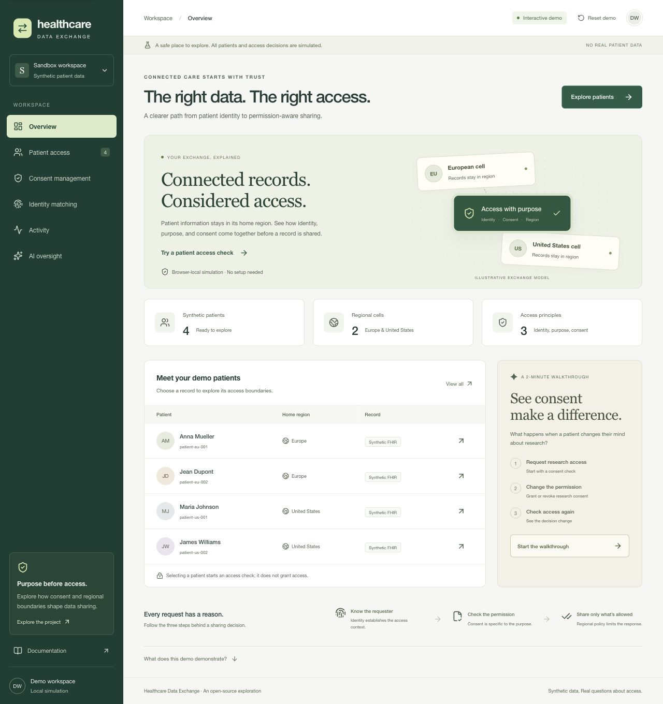

# Healthcare Data Exchange

**A guided synthetic demo of consent, requesting teams, and regional data access—with a separate FHIR, OPA, and OPAL reference backend.**

[**Open the live demo →**](https://safetymp.github.io/Healthcare-Data-Exchange/) · [Frontend setup](web/README.md) · [Documentation](docs/README.md) · [Contributing](CONTRIBUTING.md)

[](https://github.com/SafetyMP/Healthcare-Data-Exchange/actions/workflows/pages.yml)
[](https://github.com/SafetyMP/Healthcare-Data-Exchange/actions/workflows/portfolio-verify.yml)
[](https://github.com/SafetyMP/Healthcare-Data-Exchange/actions/workflows/codeql.yml)



Healthcare data access depends on more than finding a record. The purpose of a
request, the requesting team's permissions, the patient's consent, and regional
restrictions can all change what is returned. This project makes those decisions
visible and lets you explore how they interact.

The public demo works without an account or backend setup. All patients and
outcomes are synthetic. It is an educational and product-design reference, not a
clinical record system, a production health information exchange, or compliance
certification.

## Try the guided walkthrough

Open the [demo](https://safetymp.github.io/Healthcare-Data-Exchange/) and choose
**Start guided walkthrough** on Overview. Nine checkpoints use the actual forms:

1. See a research request blocked when consent is absent.
2. Grant research consent and check the same request again.
3. Revoke consent and verify that the next request is blocked.
4. Check treatment separately from research.
5. Switch requesting teams to encounter a regional restriction.
6. Confirm that saving consent does not override that restriction.
7. See why choosing a limited purpose alone does not grant permission.
8. Use the permitted team preset and inspect the limited derivative response.
9. Review the simulated decisions and consent changes in Activity.

The guide waits for matching form results before allowing you to continue. Pause
and resume it, reload the page, or explore freely. Starting or restarting the
guide resets this tab's simulated consent and activity; **Reset demo** also clears
guide progress. Browser session storage retains state across reloads when available.

Outside the guide, search four synthetic patients, compare purposes and teams,
resolve example identifiers, or inspect a fixed AI oversight example. The AI
example does not provide a clinical assessment. See the [walkthrough design](docs/guided-walkthrough.md)
and [experience notes](docs/experience-redesign.md).

## Choose your starting point

| You want to… | Start here |
|---|---|
| Understand consent and access decisions | [Live guided demo](https://safetymp.github.io/Healthcare-Data-Exchange/) |
| Review the experience or suggest improvements | [Product scope](docs/product-mandate.md), [independent experience review](docs/live-experience-review.md) |
| Run or change the frontend | [Web workspace guide](web/README.md) |
| Investigate FHIR, policy enforcement, or consent distribution | [Reference backend setup](#run-the-reference-backend), [architecture](docs/architecture/overview.md) |
| Contribute with a coding agent | [Contributing](CONTRIBUTING.md), then [AGENTS.md](AGENTS.md) |

## Two execution modes

| | Browser demo on GitHub Pages | Local reference backend |
|---|---|---|
| Purpose | Explore the experience and synthetic access scenarios | Exercise service integration and policy enforcement |
| Data and state | Four fixture patients; tab-local simulated consent and activity | Synthetic FHIR R4 patients in EU and US HAPI stores; local consent service |
| Decisions | Simplified browser fixture rules | Go gateway, verified demo credentials, OPA policy and OPAL consent distribution |
| Setup | Open a URL | Docker Compose plus the local frontend |
| Evidence | Frontend interactions, accessibility checks, static route behavior | Hermetic service tests and separate Compose scenarios |

The browser demo makes no gateway API requests and does not run OPA, OPAL, HAPI,
or a clinical AI model. Its outcomes do not establish live policy enforcement,
actual data residency, clinical validity, or legal compliance. The reference
backend uses development credentials and service stubs; it is also not a
production deployment. Neither mode accepts real protected health information.

## Run the browser demo locally

Requires Node.js **22** and npm **10.9.2–10.x**, as declared in
[web/package.json](web/package.json).

```bash
git clone https://github.com/SafetyMP/Healthcare-Data-Exchange.git
cd Healthcare-Data-Exchange/web
npm ci
npm run build:demo
npm run preview:demo
```

Open `http://127.0.0.1:3100/Healthcare-Data-Exchange/`.
For development, mode settings, tests, and publishing, see [web/README.md](web/README.md).

## Run the reference backend

From the repository root, with Docker Compose available:

```bash
./scripts/run-dev.sh
./scripts/demo.sh
./scripts/adversarial.sh
```

The startup script builds the services, creates gitignored development secrets on
first run, and waits for service health. HAPI startup can take several minutes.
The cooperative demo exercises synthetic reads and consent changes; the adversarial
script checks authorization and residency denial paths. See
[backend architecture and data flows](docs/architecture/overview.md) for the service boundaries.

In another terminal, start the gateway-backed frontend with the browser-demo
switch unset:

```bash
cd web
npm ci
npm run dev
# http://localhost:3100
```

Stop the local stack when finished:

```bash
./scripts/teardown-dev.sh
```

Default teardown retains data volumes. Never commit generated secrets or use real
patient data. The [security policy](SECURITY.md) describes reporting and boundaries.

## Verification and evidence

| Check | Command | What it covers |
|---|---|---|
| Browser demo | `cd web && npm run verify:demo` | Adapter and metadata tests, TypeScript, static export checks, browser journeys and automated accessibility |
| Gateway frontend | `cd web && npm run verify` | TypeScript, server-mode build and frontend smoke/accessibility checks |
| Reference services | `./scripts/verify.sh` | Repository contracts, OPA tests, Go vet/tests and Python lint/tests; no Compose |
| Running stack | `./scripts/demo.sh` and `./scripts/adversarial.sh` | Cooperative and adversarial service scenarios; requires Compose |

Install Chromium for frontend tests with `cd web && npx playwright install chromium`.
The hermetic backend gate requires Go **1.22+**, Python **3.12+**, PyYAML, and
`curl`; its first run may download pinned OPA and install local Python environments.
The [contribution guide](CONTRIBUTING.md) documents environment details and checks.

[GitHub Actions](https://github.com/SafetyMP/Healthcare-Data-Exchange/actions) records
remote check results. A passing frontend or hermetic test is not proof of a live
exchange. [Review records](docs/README.md#design-and-verification-records) describe
expert inspection and synthetic regression testing; improved customer engagement
has not been measured.

## Repository map

| Path | Responsibility |
|---|---|
| [`web/`](web/) | Next.js 16 / React / TypeScript workspace; browser demo and gateway mode |
| [`fhir/samples/`](fhir/samples/) | Synthetic FHIR Patient fixtures |
| [`services/`](services/) | Go gateway and Python consent, identity, and AI-governance references |
| [`policy/`](policy/) and [`config/`](config/) | Canonical OPA rules and demo routing/identity configuration |
| [`deploy/`](deploy/) | Local Compose stack |
| [`docs/`](docs/) | Current product scope, architecture, design records, and historical context |

Policy changes belong in this repository. The separate
[healthcare-policy](https://github.com/SafetyMP/healthcare-policy) repository is a
mirror, maintained by the existing sync workflow; see
[ADR 0007](docs/adr/0007-opal-policy-mirror.md). Frontend changes do not require
policy publication.

## Contribute and reuse

Read [CONTRIBUTING.md](CONTRIBUTING.md) for development and review, [SUPPORT.md](SUPPORT.md)
for questions, and [SECURITY.md](SECURITY.md) for private vulnerability reporting.
The [roadmap](docs/roadmap.md), [changelog](CHANGELOG.md), and [governance](GOVERNANCE.md)
explain direction, history, and decisions. Citation metadata is in [CITATION.cff](CITATION.cff).

Licensed under **Apache License 2.0**. See [LICENSE](LICENSE) and [NOTICE](NOTICE).
