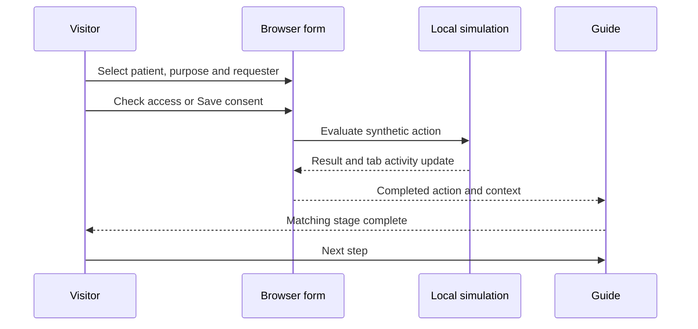
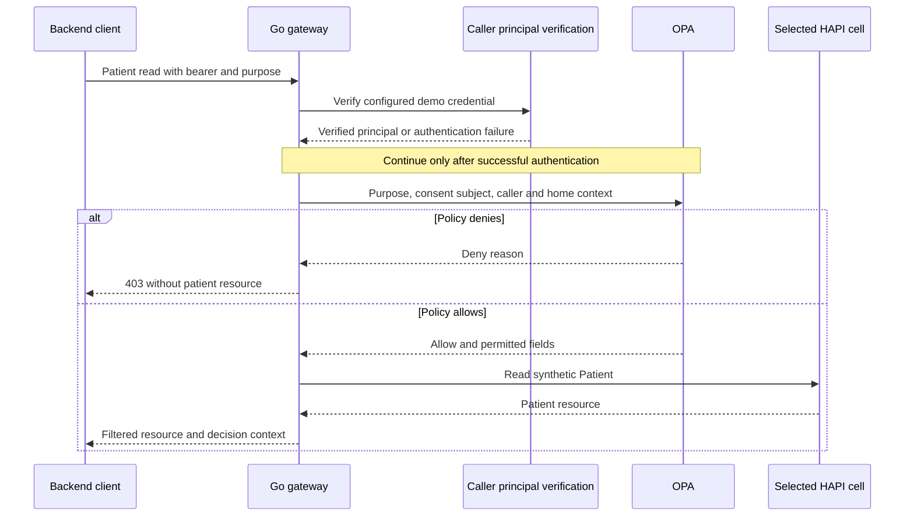

# Data flows — Healthcare Data Exchange

The browser demo and reference backend are separate execution paths. This page
shows what each path does; [architecture](overview.md) describes their components.
All examples use synthetic data.

## Guided browser walkthrough

Start from the [public demo](https://safetymp.github.io/Healthcare-Data-Exchange/).
Starting or restarting the guide resets this tab's demo consent and activity.
Anna Mueller is the selected synthetic EU patient throughout these checkpoints.

| Step | Visitor action | Expected simulated observation |
|---|---|---|
| 1. Consent protects a record | Check Research with the EU visiting care team | Blocked: research consent is not granted |
| 2. Grant and recheck | Save granted Research consent, then repeat the same request | Allowed |
| 3. Revoke and recheck | Save revoked Research consent, then repeat the same request | Blocked: consent is not granted |
| 4. Separate purposes | Check Treatment with the EU visiting care team | Allowed: treatment has its own consent preference |
| 5. Change region | Keep Treatment; select the US home care team and check | Blocked by the regional rule |
| 6. Consent does not override region | Save the already-granted Treatment preference; recheck with the same US home team | Still blocked by the regional rule |
| 7. Purpose alone is insufficient | Check Limited derivative with the US home care team | Blocked: that requester lacks the exception |
| 8. Inspect limited sharing | Check Limited derivative with the US care team preset permitting limited cross-region access | Allowed with `id` and `resourceType`; name, birth date and gender are withheld |
| 9. Review Activity | Compare the consent changes, requester contexts and access decisions; finish the guide | A tab-local simulated decision trail |

The guide enables Next after matching form actions complete. Matching includes
patient, purpose, requester, action and outcome. It does not advance just because
a page opens or because a prior activity entry exists. Step 9 ends with an explicit
Finish action on Activity. The [checkpoint definitions](../../web/src/lib/walkthrough.ts)
and [guide component](../../web/src/components/walkthrough/guided-walkthrough.tsx)
are the implementation sources.

Pause keeps the current checkpoint and permits free exploration; actions while
paused do not advance the guide. Resume and Return to this step restore the
checkpoint's route and selections without submitting a request or changing consent.
With session storage available, progress survives a reload. Reset demo clears it.

The normal allowed response contains the fixture's `id`, `resourceType`, `name`,
`birthDate` and `gender`. A blocked response contains the denial reason, not the
patient resource. The limited response still includes a synthetic record ID; it
must not be described as anonymous or as a real-world transfer authorization.

## Other browser routes

| Route | Actual behavior | Limit |
|---|---|---|
| Identity matching | Resolve a configured synthetic preferred identifier or sample record ID; continue to Patient access | A match does not grant access; no live NCP or QHIN lookup |
| AI oversight | Submit example inputs and receive a fixed result marked `pending_human_oversight` | No clinical model, diagnosis, prioritization, or approval/rejection action |
| Activity | Show recent simulated actions from this tab | No backend audit feed; reset clears the entries |

These routes use [local simulation functions](../../web/src/lib/demo.ts) in the
published demo. Requesting-team presets illustrate identity context; they do not
establish a visitor's real identity or permissions.

## Reference backend patient read

The separately run backend evaluates a patient read through the gateway and OPA.
The gateway derives requester attributes from the verified caller principal, not
from a requester-jurisdiction query parameter. Consent comes from OPA's
`data.consent`, published through the consent-service/OPAL path.

The [gateway handlers](../../services/gateway/internal/handlers/handlers.go) and
[Rego policy](../../policy/authz.rego) define this path. The exception filters to
`id` and `resourceType`; it does not compute summarized lab results or establish a
legal basis for transfer. The local Compose cells are logical partitions, not
proof of physical EU/US residency.

Backend consent updates require the administrator route and propagate through
OPAL; verifying the resulting policy decision requires a subsequent backend read.
See [ADR 0008](../adr/0008-opal-consent-sync.md). The backend identity service uses a
demo registry. Its AI governance service has stub approve/reject endpoints, which
the public browser demonstration does not expose. See the
[component sources](overview.md#separate-reference-backend).

## Historical proposed flows

The [original data-flow document at revision bae1c21](https://github.com/SafetyMP/Healthcare-Data-Exchange/blob/bae1c21d9b3bbb5faf98d660ea39bf68d44f9e34/docs/architecture/data-flows.md)
preserves proposed NCP/QHIN exchange, envelope decryption, derivative transformation,
erasure and AI lifecycle diagrams. Those diagrams are historical design evidence,
not a description of the guided browser experience or proof of a production system.
Backend execution claims need the scoped test evidence described in
[architecture](overview.md#evidence-boundaries).
