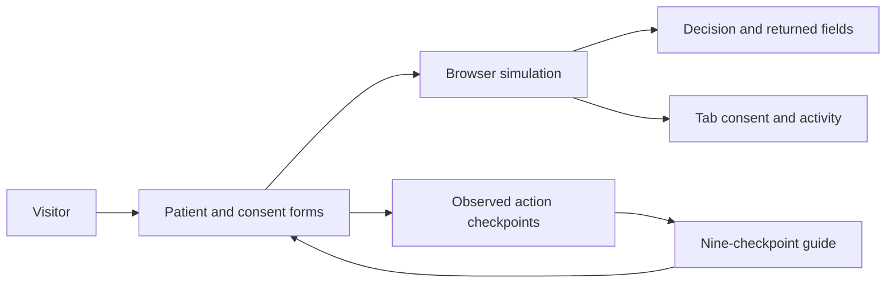
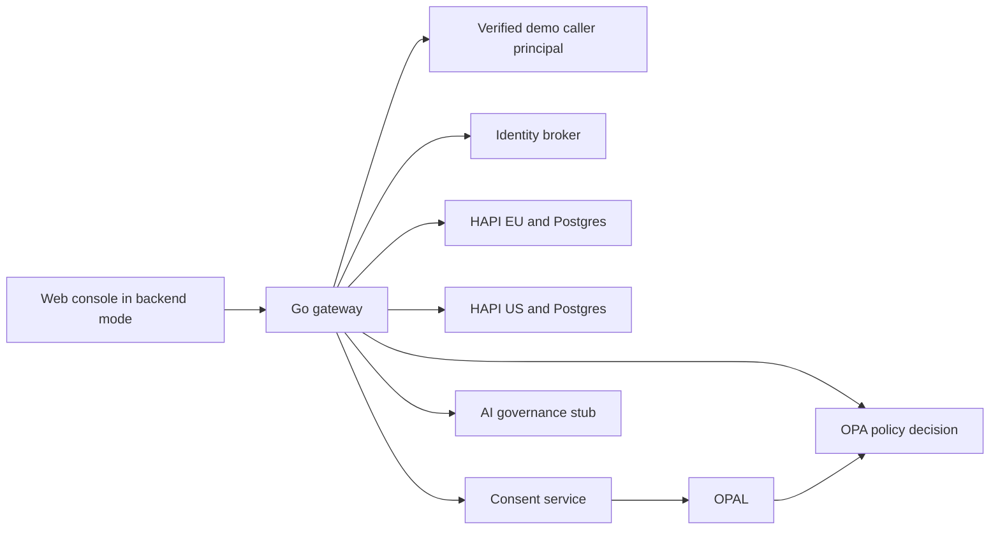

# Architecture — Healthcare Data Exchange

Healthcare Data Exchange has two execution modes: a guided synthetic browser demo
and a separate FHIR/OPA/OPAL reference backend. The public demo runs locally in the
visitor's browser; its decisions do not establish that backend services ran.
The [project overview](../../README.md) and [product mandate](../product-mandate.md)
define the current scope.

## Browser demo

The Next.js application is built with `NEXT_PUBLIC_DEMO_MODE=true` and exported as
static files for GitHub Pages. [Build configuration](../../web/next.config.ts)
disables the backend rewrite in this mode. [API dispatch](../../web/src/lib/api.ts)
calls the local [simulation functions](../../web/src/lib/demo.ts), not the gateway.

Four fictional patient records support exploration of purpose-specific consent,
requester presets, regional restrictions, and a limited derivative exception. The
[nine checkpoints](data-flows.md#guided-browser-walkthrough) use the same forms as
free exploration. The guide observes completed matching actions; it does not
submit access requests or save consent on the visitor's behalf.

Consent, recent activity, selected context, and guide progress use browser session
storage. The demo falls back to page memory when storage is unavailable; persistence
across reloads is then unavailable. Starting or restarting the guide resets this
tab's consent and activity. Pausing preserves them. Reset demo also clears guide
progress. These are synthetic preferences, not changes to patient records or
production authorization policies.

Identity matching uses a small synthetic registry. The AI oversight page generates
a fixed example marked as pending human review. It neither runs a clinical model
nor provides approve/reject controls. Activity is a tab-local list, not a production
audit log.

## Separate reference backend

With demo mode disabled, the web application rewrites `/api/*` to the configured
Go gateway. Local Compose supplies two HAPI FHIR/Postgres cells and the supporting
services. This is a local reference implementation, not geographically deployed EU
and US infrastructure.

| Component | Implemented role | Source |
|---|---|---|
| Go gateway | Resolves caller identity, evaluates policy, routes reads and filters returned fields | [handlers](../../services/gateway/internal/handlers/handlers.go), [principal](../../services/gateway/internal/principal/) |
| OPA / Rego | Checks purpose-specific consent, regional rules, permitted exception and exchange-purpose codes | [policy](../../policy/authz.rego) |
| Consent service / OPAL | Publishes consent data used by OPA | [ADR 0008](../adr/0008-opal-consent-sync.md), [ADR 0011](../adr/0011-opal-production-hardening.md) |
| HAPI FHIR / Postgres | Separate synthetic EU and US data stores in the Compose stack | [Compose](../../deploy/docker-compose.yml), [samples](../../fhir/samples/) |
| Identity broker | Preferred-identifier or subject lookup in a demo registry, with a registration endpoint | [service](../../services/identity-broker/chex_identity/main.py) |
| AI governance | Fixed-score stub, in-memory model/decision records and approve/reject endpoints | [service](../../services/ai-governance/chex_ai_governance/main.py) |
| Software key store | Reference tenant-key lifecycle and shred behavior; not production HSM or complete database erasure | [implementation](../../services/gateway/internal/crypto/keystore.go), [ADR 0003](../adr/0003-key-custody-crypto-shred.md) |

Backend patient-read identity comes from verified per-cell demo credentials.
Browser query parameters select demo context; they are not backend authentication.
See [ADR 0000](../adr/0000-threat-model.md) and the
[threat-model specification](../../specs/threat-model.yaml).

## Evidence boundaries

- `cd web && npm run verify:demo` checks the browser implementation against local
  synthetic scenarios. A successful run is not proof of the deployed revision.
- `./scripts/verify.sh` checks backend code, policy and repository contracts without
  a running Compose stack. It does not run the browser suite.
- `./scripts/demo.sh` and `./scripts/adversarial.sh` exercise a running backend.
  Claims about those paths require their own results for the revision tested.
- A deployed-browser review verifies the particular URL, revision and interactions
  observed. It does not establish compliance, clinical safety or production readiness.

## Historical target architecture

The [original architecture at revision bae1c21](https://github.com/SafetyMP/Healthcare-Data-Exchange/blob/bae1c21d9b3bbb5faf98d660ea39bf68d44f9e34/docs/architecture/overview.md)
retains the earlier “Cloud Healthcare Exchange” design, illustrations and proposed
federated control plane. Per-cell gateways, NCP/QHIN federation, Kubernetes/service
mesh, HSM custody and production compliance ambitions are historical proposals,
not features established by the browser demo. The [ADRs](../adr/) preserve the
decision record; each document's status and implementation limits still matter.

See also [data flows](data-flows.md), [compliance and evidence boundaries](compliance-mapping.md),
and the [reference index](../references.md).
